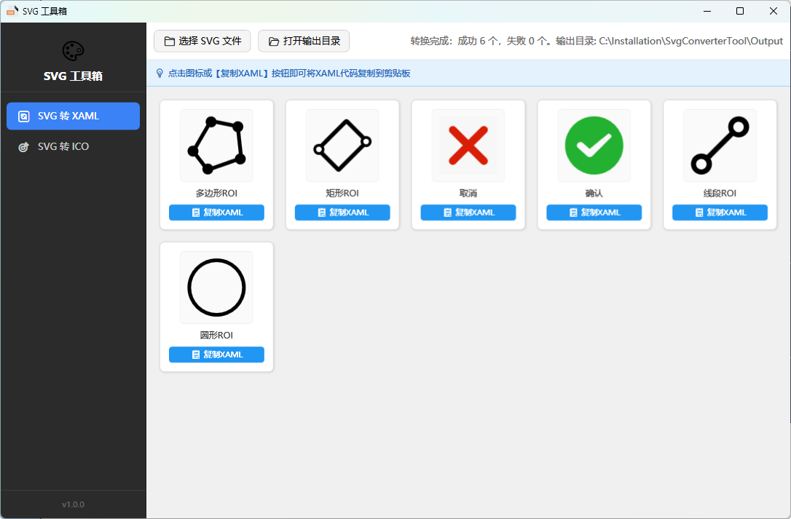

# SVG Converter Tool — SVG 转换工具

> 一款专为 WPF / Windows 开发者设计的 SVG 批量转换工具，支持 SVG 转 XAML、SVG 转 ICO。
> 灵感来自 [SvgXaml](https://github.com/ElinamLLC/SvgXaml)，核心转换能力基于 [SharpVectors](https://github.com/ElinamLLC/SharpVectors)。

---

## 1. 项目背景与动机

### 为什么写这个项目

在日常 WPF 开发中，我经常遇到这样的场景：我从网上下载了一套 SVG 图标，需要把它转成 WPF 可直接使用的 `DrawingImage` XAML、生成多尺寸的 ICO 图标、并导出 PNG 备用。

这件事本身不难，但反复做就很繁琐。

在寻找解决方案时，我接触到了 [SvgXaml](https://github.com/ElinamLLC/SvgXaml)——由 SharpVectors 团队开发的 SVG 转 XAML 桌面工具。它证明了「SVG → WPF DrawingImage」这条路径完全可行，也是这个项目的**灵感来源**。

但在我个人的图标整理工作流中，SvgXaml 仍有几个不够顺手的地方：

- SvgXaml 转换的结果多嵌套了一层 DrawingImage
- 转换结束后需要打开 xaml 文件后手动复制
- 除了 XAML，我还想要 ICO（多尺寸）和 PNG，能一次性产出

于是决定写一个更贴合自己需求的工具：**批量选择、异步转换、多格式一次产出、实时预览、一键复制**。所有格式转换能力都直接建立在 [SharpVectors](https://github.com/ElinamLLC/SharpVectors) 之上——它是本项目的核心引擎，负责 SVG 的解析与渲染；SvgXaml 则为产品形态提供了参考。

---

## 2. 功能特性

| 功能 | 说明 |
|------|------|
| 🔄 **SVG 转 XAML** | 将 SVG 转换为纯净的 `DrawingImage` XAML，可直接嵌入 WPF 资源字典 |
| 🎯 **SVG 转 ICO** | 生成包含 6 种尺寸（16/32/48/64/128/256）的 Windows 图标文件 |
| 🖼️ **同步导出 PNG** | XAML 转换时自动同步生成 PNG 预览图 |
| 📋 **一键复制 XAML** | 点击任意结果卡片，XAML 代码自动复制到剪贴板 |
| 📁 **批量异步处理** | 支持同时选择多个 SVG 文件，Task 后台执行，界面不卡顿 |
| 📊 **实时进度显示** | 进度条 + 计数文字，实时显示转换进度 |
| 🎨 **SVG 矢量预览** | 预览图基于矢量渲染，任意缩放都清晰锐利 |
| 🪟 **自适应网格布局** | 窗口大小调整时，结果网格自动计算列数，填满空白 |
| 📂 **自动输出管理** | 所有输出文件统一存放在程序目录下的 `Output` 文件夹 |

---

## 3. 获取与编译

### 3.1 获取方式

- **方式一（推荐）**：从 **GitHub Releases** 下载便携包，解压后双击 `SvgConverterTool.exe` 即可运行，无需安装
- **方式二**：从源码自行编译（见 3.4）

### 3.2 Release 压缩包说明

Release 提供两种便携包（zip），均免安装、解压即用，区别仅在于是否内置 .NET 运行时：

| 压缩包 | 说明 | 体积 | 运行要求 |
|--------|------|------|---------|
| `SvgConverterTool-win-x64-portable.zip` | 自包含版，内置 .NET 8 运行时 | 约 60~80 MB | 无需安装任何运行时 |
| `SvgConverterTool-win-x64-framework-dependent.zip` | 框架依赖版 | 约 2 MB | 需安装 [.NET 8 Desktop Runtime](https://dotnet.microsoft.com/download/dotnet/8.0) |

> **推荐**：不熟悉 .NET 环境的用户选**自包含版**；WPF 开发者机器通常已装 .NET，选**框架依赖版**体积更小。

### 3.3 系统要求

- **操作系统**：Windows 10 / Windows 11
- **编译需要**：[.NET 8 SDK](https://dotnet.microsoft.com/download/dotnet/8.0)
- **运行（框架依赖版）**：需要安装 [.NET 8 Desktop Runtime](https://dotnet.microsoft.com/download/dotnet/8.0)；自包含版无需任何运行时

### 3.4 从源码编译

```bash
# 1. 克隆仓库
git clone <仓库地址>
cd <仓库地址目录>

# 2. 还原依赖并编译
dotnet build src/SvgConverterTool/SvgConverterTool.csproj -c Release

# 3. 运行
dotnet run --project src/SvgConverterTool/SvgConverterTool.csproj
```

编译产物位于 `src/SvgConverterTool/bin/Release/net8.0-windows/`。

项目使用 `src/SvgConverterTool.slnx` 解决方案文件，也可以直接用 IDE（Visual Studio 2022 17.10+ / Rider）打开该解决方案进行编译。

---

## 4. 界面介绍



### 左侧导航栏
- **SVG 转 XAML**：格式转换主功能
- **SVG 转 ICO**：图标生成功能
- 点击切换功能，当前选中项高亮显示

### 右侧内容区
- **工具栏**：文件选择、输出目录、进度条、状态文字
- **提示栏**：当前功能的使用提示
- **结果网格**：自适应网格布局，卡片展示转换结果

### 自适应布局

窗口宽度变化时，结果网格会自动调整每行显示的卡片数量：

| 窗口宽度 | 每行卡片数 |
|----------|-----------|
| ~400 px | 2 张 |
| ~600 px | 3 张 |
| ~800 px | 4 张 |
| ~1200 px | 6 张 |
| ~1600 px | 8 张 |

卡片宽度在 `120px ~ 160px` 之间自适应拉伸，始终填满整行。

---

## 5. 使用说明

### 5.1 SVG 转 XAML

1. 在左侧导航栏点击 **「SVG 转 XAML」**
2. 点击工具栏 **「📁 选择 SVG 文件」**，可多选
3. 转换自动在后台执行，进度条实时更新
4. 结果以卡片网格展示：
   - 上方为 **SVG 矢量预览图**（清晰无锯齿）
   - 中间为文件名
   - 下方为 **「📋 复制XAML」** 按钮
5. 点击任意卡片或按钮，XAML 代码即复制到剪贴板

**输出文件**（位于 `Output` 目录）：

| 文件            | 说明                            |
| --------------- | ------------------------------- |
| `{文件名}.xaml` | 纯净的 `DrawingImage` XAML 代码 |
| `{文件名}.png`  | PNG 预览图                      |
| `{文件名}.svg`  | 原始 SVG 备份                   |
| `{文件名}.ico`  | 自动同步生成的 ICO 图标         |

**XAML 输出示例**：

```xml
<!--新建图标-->
<DrawingImage>
    <DrawingImage.Drawing>
        <DrawingGroup>
            <!-- SVG 路径数据 -->
        </DrawingGroup>
    </DrawingImage.Drawing>
</DrawingImage>
```

特点：

- 已去除 `x:Name` 和冗余的 `xmlns` 声明
- 已去除外层的 `ResourceDictionary` 包装
- 直接可用作 WPF `Image.Source` 或放入资源字典

---

### 5.2 SVG 转 ICO

1. 在左侧导航栏点击 **「SVG 转 ICO」**
2. 点击 **「📁 选择 SVG 文件」**，可多选
3. 后台异步生成，进度条实时显示
4. 每个结果卡片展示：
   - **SVG 矢量预览图**
   - 文件名 + `.ico` 后缀

**生成的 ICO 规格**：

| 属性     | 值                                           |
| -------- | -------------------------------------------- |
| 图像数量 | 6 张                                         |
| 尺寸     | 16×16, 32×32, 48×48, 64×64, 128×128, 256×256 |
| 位深     | 32 bpp（RGBA，含 Alpha 透明通道）            |
| 图像格式 | PNG 嵌入（压缩率高，体积小）                 |
| 典型体积 | 10 ~ 20 KB                                   |

---

## 6. 技术架构

### 6.1 设计思路

本项目的**格式转换能力完全基于 SharpVectors**：

- SVG 的解析、渲染由 SharpVectors 完成（`FileSvgReader` / `FileSvgConverter` / `ImageSvgConverter` / `WpfDrawingSettings`）
- 本工具在其之上负责：批量调度、XAML 后处理（去冗余属性）、PNG/ICO 编码、进度与预览等外围能力
- 产品形态与交互流程参考了 SvgXaml，并针对批量图标整理工作流做了扩展（多格式同步导出、批量异步、一键复制）

### 6.2 项目结构

```
SvgConverterTool/
├── App.xaml / App.xaml.cs          ← 应用程序入口
├── MainWindow.xaml / .xaml.cs      ← 主窗口（左侧导航 + 右侧内容区）
├── Models/
│   └── SvgConvertResult.cs         ← SVG 转换结果数据模型
├── Views/
│   ├── SvgConvertView.xaml / .cs   ← SVG 转 XAML 页面
│   └── IcoConvertView.xaml / .cs   ← SVG 转 ICO 页面
├── External/
│   └── file-svg.svg                ← 程序图标源文件
├── app.ico                         ← 程序图标
└── SvgConverterTool.csproj
```

### 6.3 核心技术栈

| 技术 | 用途 |
|------|------|
| **.NET 8 + WPF** | 桌面应用程序框架 |
| **SharpVectors.Wpf** | SVG 解析与渲染（支持 SVG 1.1），本项目核心引擎 |
| **XDocument** | XAML 后处理（去除冗余属性） |
| **RenderTargetBitmap** | SVG → PNG / ICO 位图渲染 |
| **PngBitmapEncoder** | PNG 编码 |
| **Task + IProgress<T>** | 异步转换与进度报告 |
| **ObservableCollection** | UI 数据绑定 |

---

## 7. 开源与依赖

### 灵感来源

| 项目 | 说明 |
|------|------|
| [SvgXaml](https://github.com/ElinamLLC/SvgXaml) | SharpVectors 团队出品的 SVG 转 XAML 桌面工具，本项目产品形态的灵感来源 |

### 核心依赖

| 包名 | 版本 | 许可证 |
|------|------|--------|
| [SharpVectors.Wpf](https://github.com/ElinamLLC/SharpVectors) | 1.8.5 | BSD-3-Clause |

本项目所有格式转换能力均基于 SharpVectors，其可访问本仓库的其余部分（如 [SharpVectors](https://github.com/ElinamLLC/SharpVectors)）获取更多信息。
